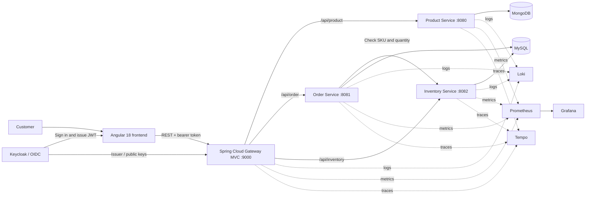

# Commerce Microservices Platform

A portfolio project demonstrating a service-based commerce backend with Spring Boot, an API gateway, OAuth2/JWT authentication, polyglot persistence, and Kubernetes/observability configuration.

## Architecture



An order request checks stock through the Inventory Service before the Order Service persists the order. The gateway validates JWTs issued by Keycloak and routes requests to the backend services. Springdoc exposes OpenAPI documentation for the services and an aggregated Swagger UI through the gateway.

## Services

| Component | Responsibility | Local port |
| --- | --- | ---: |
| Angular shop frontend | Product browsing and order submission UI | `4200` |
| API Gateway | Routes `/api/*` requests, validates JWTs, aggregates API docs, and applies resilience policies | `9000` |
| Product Service | Product API and catalog persistence | `8080` |
| Order Service | Validates stock with Inventory and stores orders | `8081` |
| Inventory Service | Answers SKU availability checks | `8082` |
| Keycloak | OIDC identity provider and JWT issuer | `8181` in Compose |

The Product Service uses MongoDB. Order and Inventory share the MySQL server while keeping separate databases. Loki, Prometheus, Grafana, and Tempo provide centralized logs, metrics, dashboards, and traces.

## Technology

- **Backend:** Java 21, Spring Boot 3, Spring Cloud Gateway MVC, Spring Security OAuth2 Resource Server, Resilience4j, Springdoc OpenAPI
- **Frontend:** Angular 18, TypeScript
- **Data:** MongoDB, MySQL, Flyway
- **Identity:** Keycloak, OpenID Connect, JWT
- **Platform & delivery:** Docker, Docker Compose, Kubernetes (Kind manifests), Argo CD, Jenkins, SonarQube, Trivy
- **Observability:** Spring Boot Actuator, Micrometer/Prometheus, Loki, Grafana, Tempo

## Quick Start

### Prerequisites

- Java 21 and Maven
- Docker with the Compose plugin
- Node.js and npm

### 1. Start local databases and observability services

From the repository root:

```bash
docker compose up -d mongodb mysql loki prometheus tempo
```

The Compose file provides supporting infrastructure; it does **not** start the application services.

### 2. Start the backend

Run each command in a separate terminal from the repository root:

```bash
mvn -pl product-service spring-boot:run
mvn -pl inventory-service spring-boot:run
mvn -pl order-service spring-boot:run
mvn -pl api-gateway spring-boot:run
```

The services use the local database settings in their `application.properties` files. These settings are for isolated development only; do not reuse the demo credentials in a shared or production environment.

### 3. Start the frontend

```bash
cd microservices-shop-frontend
npm ci
npm start
```

Open `http://localhost:4200`. The aggregated API documentation is configured at `http://localhost:9000/swagger-ui.html`.

### Local setup notes

- The frontend currently points its API and Keycloak URLs to the hosted shop domain. For a local end-to-end browser flow, configure these URLs for the local gateway and identity provider.
- Compose maps Keycloak to port `8181`, while the gateway's default issuer URL uses port `8080`; the Keycloak Compose database host also needs to match the `keycloak-mysql` service. Align these settings before testing local JWT authentication.
- Grafana in the supplied development configuration has anonymous Admin access. Keep the monitoring stack on a trusted local machine; do not expose it publicly as configured.

## API examples

```bash
# List products
curl http://localhost:8080/api/product

# Check stock
curl "http://localhost:8082/api/inventory?skuCode=SKU-001&quantity=1"
```

The gateway exposes the corresponding service routes under `/api/product`, `/api/order`, and `/api/inventory`. Protected gateway requests require a valid Keycloak JWT.

## Deployment and project scope

Kubernetes manifests are under `k8s/manifests/`; Kind helper scripts are under `k8s/kind/`. `Jenkinsfile` describes the CI pipeline. Review image tags, secrets, and environment-specific URLs before applying the manifests to a cluster.

This checkout currently contains the Gateway, Product, Order, and Inventory backend modules. Kafka event publishing is commented out in the Order Service, and a Notification Service is not present as a Maven module. Test dependencies are included, but backend test source files are not currently present.
